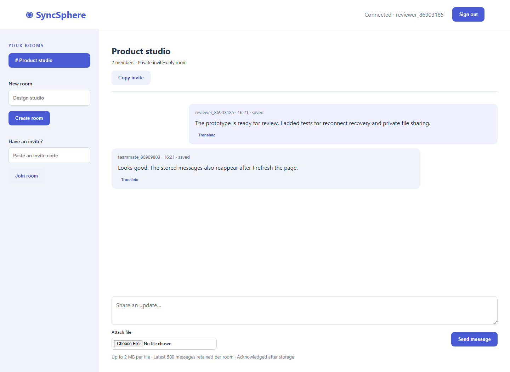
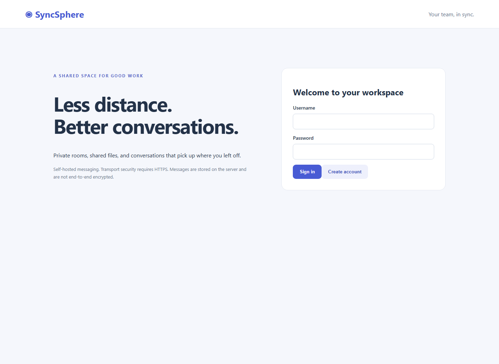
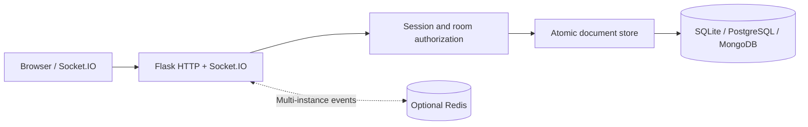

# SyncSphere

**Team conversations that survive a disconnected tab.**

[Try the live workspace](https://syncsphere-29f5.onrender.com) | Create a demo account and invite a second browser account into a private room. Free hosting may take a minute to wake after inactivity.

[](https://github.com/Shreeya1807/SyncSphere/actions/workflows/ci.yml)

A Flask-SocketIO messaging workspace with private invite-only rooms, durable messages, acknowledged sends, bounded history recovery, file sharing, and optional message translation. SQLite makes local review simple; PostgreSQL provides durable hosted storage, and MongoDB with Redis supports coordinated server processes.

## Interface



<details>
<summary>Account entry screen</summary>



</details>

The conversation screenshot comes from two actual accounts on the hosted demo after sending messages and reloading the conversation. All messages shown are synthetic demonstration content.

## Two-minute review

1. Open the live workspace and create an account; use a second browser profile for another account.
2. Create a room, copy its invite, and join from the second account.
3. Send messages in both directions, then refresh: saved history reappears.
4. Open [CI results](https://github.com/Shreeya1807/SyncSphere/actions/workflows/ci.yml) to inspect storage, multi-server delivery, and container checks.

### Architecture



## Run locally

Python 3.12 recommended. No account, cloud key, or database server is needed for the local SQLite mode.

```bash
python -m venv .venv
# Windows: .venv\Scripts\activate
# macOS/Linux: source .venv/bin/activate
python -m pip install -r requirements-modern.txt
python run.py
```

Open http://127.0.0.1:5000. Create an account with a password of at least ten characters, create a room, then open a second browser profile and create another account. Share the room invite to join and exchange messages. Local data and the generated session-signing key live in the ignored `data/` directory.

The supported entry point is `run.py`. Root-level historical scripts and old templates remain for provenance; they are not the supported server or included in the container.

## Working features

- Password hashing and revocable seven-day sessions; CSRF checks for HTTP writes and authenticated socket handshakes.
- Invite-only rooms with membership checks on history, messages, and every file download.
- Acknowledgment only after persistence. Client-generated IDs make identical retries idempotent within retained history; conflicting retries are rejected.
- Atomic per-room sequence allocation and bounded retention of the latest 500 messages. Reconnect subscribes and replays history, merging by message ID.
- File sharing for PDF, text, CSV, PNG and JPEG up to 2 MB. Downloads are forced attachments; arbitrary executable uploads are rejected.
- Optional LibreTranslate-compatible translation, requested explicitly by the reader. Unconfigured or failed providers produce visible errors; original messages remain available.
- Shared storage-backed request budgets, readiness probes, Docker packaging, and regression/integration workflows.

## MongoDB and Redis deployment

Copy `.env.example` to `.env`, replace `SECRET_KEY` with a random secret, then:

```bash
docker compose up --build -d --wait
```

Open http://127.0.0.1:5000. Compose starts MongoDB, Redis and a single Gunicorn process with threads. Databases have persistent volumes and are not published to the host network. The image contains only the supported application.

For multiple application processes, use separate single-worker instances with the same MongoDB, Redis URL and session secret. Do not set Gunicorn workers above one and assume Socket.IO polling will work: polling requires sticky routing. The supplied browser uses WebSocket transport. Put HTTPS and WebSocket-capable routing in front of remote deployments and set `COOKIE_SECURE=1`.

Redis distributes live events; MongoDB is the durable source of truth. If a broadcast is missed after a successful save, reconnect history recovers retained messages. This is not an exactly-once delivery guarantee. Retrying after a message has aged out of the 500-message window can create another message.

## Translation

Set `TRANSLATE_URL` to a trusted LibreTranslate-compatible `/translate` endpoint and, if needed, `TRANSLATE_KEY`. These variables belong in the process environment; Compose can be extended to pass them. Clicking Translate sends that message to the configured service. No claim is made that translation works without a provider.

## Verification

```bash
python -m pytest -q
```

Local tests cover session revocation, CSRF, password hashing, membership isolation, storage acknowledgments, retry deduplication, conflicting retries, disconnected history recovery, attachment authorization, concurrent storage updates, and restart persistence. The service integration test is skipped locally unless `INTEGRATION_SERVICES=1`; CI runs it against real MongoDB and Redis with two separate server processes. It checks cross-process delivery and recovery after restarting the receiving server. Another CI job builds and starts the Compose stack.

## Security and operational boundaries

Messages are stored on the server. This version does **not** claim end-to-end encryption. Use HTTPS for transport encryption, protect database access and backups, and limit deployments to intended users. Room invites are bearer capabilities: anyone with one and an account can join. There is no room-member removal UI yet. This is a portfolio application, not a compliance-certified communications service.

The historical public source contained a mail credential. Current code reads `SMTP_PASSWORD` from the environment, but deleting a literal does not revoke it or erase Git history. The credential owner must revoke it. The modern server does not use that legacy mail integration.

File attachments and account data currently require operator-managed retention. The SQLite mode supports one host; production capacity must be measured for the intended deployment. Redis availability is necessary for multi-process broadcast coordination.

## Provenance

This repository preserves the original SyncSphere project and its Git history from [hemanshu03/SyncSphere](https://github.com/hemanshu03/SyncSphere). The supported implementation is in `syncsphere/`; historical project work and collaborators are not represented as newly authored code. The bundled Socket.IO browser client retains its MIT license in `syncsphere/web/socket.io.LICENSE`.

## Container releases

A `v*` tag or manual release reruns the full CI workflow before publishing a commit-addressed image to GitHub Container Registry with provenance and a software bill of materials. No image is published from a failed verification run. Hosting still requires a compatible runtime and persistent storage where applicable; publishing an image is not a cloud deployment.

## PostgreSQL hosting

For a single application instance, set `DATABASE_URL` to a PostgreSQL connection URL, leave `MONGO_URL` and `REDIS_URL` unset, and provide a persistent random `SECRET_KEY`. Set `COOKIE_SECURE=1` behind HTTPS. Hosted connections should use `sslmode=verify-full`; the application supplies a trusted CA bundle. The table is created on first startup.

Transactions use per-document advisory locks, including first writes, so concurrent updates cannot overwrite one another. Failed updates roll back. PostgreSQL CI runs the authorization, messaging, concurrency, rollback and restart tests against a real PostgreSQL 17 service. Each operation opens a bounded-time connection; this deployment is intended for a small portfolio workload. Multiple instances additionally require shared Redis event delivery and suitable WebSocket routing.

Free hosting may sleep when idle and has shared resource quotas. Keep real sensitive information out of the public demo. Translation still requires a separate compatible provider.

## Hosted delivery

`render.yaml` describes a free Docker service. When importing this blueprint with a connected GitHub account, it requests deployment after CI checks pass. The current public demo was deployed manually from a verified commit; merely adding this file does not connect an existing service to GitHub. Free services can sleep and share account quotas.

For updates, run the repository checks, confirm the intended commit in GitHub Actions, and deploy that commit from Render. Confirm the readiness endpoint and repeat the documented browser walkthrough. Roll back to the last verified deploy in Render if a release fails. Database schema changes need a separate compatibility and backup plan; reverting application code does not revert stored data.
